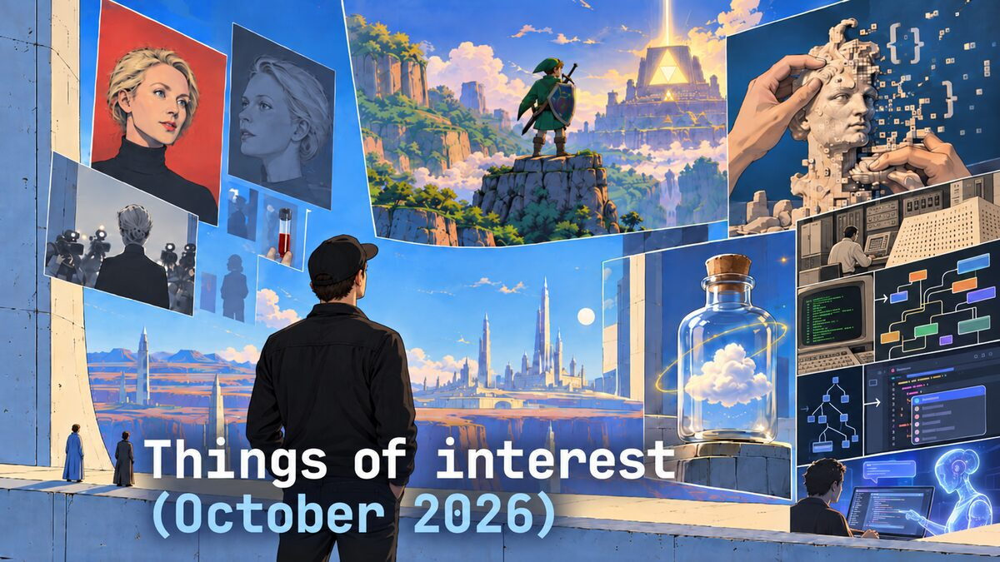
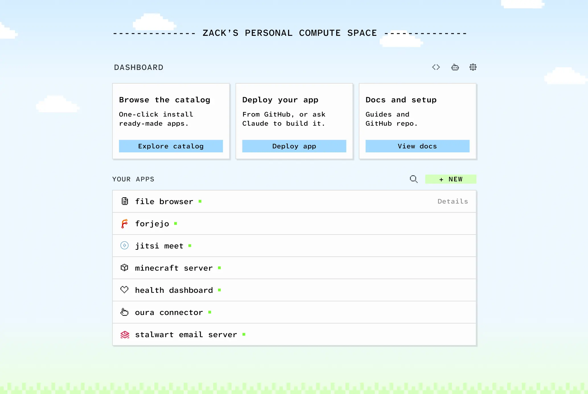

Here's a smattering of things I found interesting lately. Tools, articles, and three-hour metadocumentaries.

[You Can See Everything](https://www.themoviedb.org/movie/1765072-you-can-see-everything)

I've been to the theater [more than usual](/2026/08/movie-theaters-are-so-back/) lately, but I don't think I've *ever* left my house to watch a documentary. That lasts three hours. On opening weekend. The hype was 100% real. I absolutely loved it. Except for one scene.[^1]

[Writing isn't thinking](http://jimmyhmiller.com/writing-isnt-thinking)

Jimmy Miller with another contrarian banger:

> Writers who teach that writing is thinking are too good at writing to give advice to others. Communicating in writing is still a skill I struggle with. I do not instinctively know its contours, how to use it to get the effect I want from my readers. How to keep their attention. Writing my thoughts will never achieve that.

Knowing Jimmy –a writer whose abilities I admire– struggles to communicate gives me hope for my own writing. Some day, I may be able to communicate in writing as well as he can.

[How fast will your local model feel?](https://llmspeed.dev/)

"Pick hardware and a model. Feel the real speed before you buy." Similar to [CanIRun.ai](https://www.canirun.ai/), which I linked in July's edition.

[Cloud in a Bottle](https://cloudinabottle.org/blog/launch-post)

> your open-source personal cloud: containerized apps, unified auth, good UX. Self-hosting should feel like using a smartphone that serves webapps, not a sysadmin side job.

[Tell the speakers that you liked their talks](https://ohhelloana.blog/tell-the-speakers/)

In a world where the only certainty is *uncertainty*, stumbling across some timeless advice like this from Ana Rodrigues feels like finding twenty bucks in an old jacket pocket.

> So, if you always wanted to but think it isn't worth telling a speaker you liked their talk, this is your encouragement post to do so. It is always worth it even if it is a small tap and small chat. People put a lot of work into it and they want people to enjoy it and, at least for me, I kinda do want to know if we did alright.

[Replace PRs with Delta](https://zed.dev/blog/delta-public-beta)

I saw Cursor's GitHub replacement coming a mile away, but I did NOT expect Zed's! In retrospect, I should've.

> Today, we're launching the public beta of Delta, a multiplayer environment for coding with agents and reviewing what they build. We're building Delta because agents have fundamentally changed the way we write software, but our collaborative tooling isn't keeping up.

Nathan's team is super talented. I hope Delta is a huge success.

[Senior engineers are the next DRAM shortage](https://blog.herlein.com/post/build-another-engineer/)

> There’s a shortage coming that nobody’s put on a slide yet: senior engineers. Every company on earth is about to want one who can drive a fleet of agents with judgment — and almost nobody is making new ones anymore, because AI ate the entry-level work juniors used to learn on.

[Evolving programming languages in the AI era](https://x.com/josevalim/status/2103133294317445290)

There are few people more qualified to opine on this topic than José Valim. He asks all the hard questions. Will people still join efforts and collaborate on the same solution? If humans are no longer writing the code, does ergonomics matter? Perhaps coding agents will replace compilers and write assembly directly?

[John Gruber on Charlie Munger on Elon Musk](https://daringfireball.net/linked/2026/10/16/munger-on-musk)

“Never underestimate the man who overestimates himself.” I like that. I also really like the guy's [cars](https://jerodsanto.net/2026/07/one-year-of-living-in-the-future/).

[Ants in the machine](https://ben3d.ca/blog/ants_in_the_machine)

Ben Houston believes that communicating swarms of LLM agents will become "as omnipresent in our digital environment as ants are in our biological one."

I don't disagree. But we're going to need a LOT more electricity first.

[Tycho’s burning man sunrise set for 2026](https://kottke.org/26/09/tychos-burning-man-sunrise-set-for-2026)

<iframe width="100%" height="166" scrolling="no" frameborder="no" allow="autoplay; encrypted-media" src="https://w.soundcloud.com/player/?url=https%3A//api.soundcloud.com/tracks/soundcloud%253Atracks%253A2397740877&color=%23ff5500&auto_play=false&hide_related=false&show_comments=true&show_user=true&show_reposts=false&show_teaser=true"></iframe>
<a href="https://soundcloud.com/tycho" title="Tycho" target="_blank" style="color: #cccccc; text-decoration: none;">Tycho</a> · <a href="https://soundcloud.com/tycho/transformation-burning-man" title="Transformation - Tycho Burning Man Sunrise 2026" target="_blank" style="color: #cccccc; text-decoration: none;">Transformation - Tycho Burning Man Sunrise 2026</a>

For my money,[^2] Tycho is the greatest [chillwave](https://en.wikipedia.org/wiki/Chillwave) artist of all times. I try to never miss these annual Burning Man[^3] sets.

[Python Workers are now generally available](https://blog.cloudflare.com/python-workers-ga/)

I guess this feature is a couple years old and GA is the big announcement here.

> What does GA mean? It means Python is now a first-class, fully supported language on the Cloudflare Developer Platform. You can bring the Python code, libraries, and design patterns you already know and connect them seamlessly to Workers AI, R2, D1, Hyperdrive, Durable Objects, Queues, Workflows, and the rest of the Cloudflare platform.

I'm not *huge* on Python, as you may well know, but I'm becoming increasingly *huge-er* on Cloudflare as a platform and more ecosystem options on Workers is a (relatively) *huge* deal. When Go?

[The apostrophe’s in the wrong place show I’m human](https://sidsite.com/posts/apostrophes/)

> I’ve begun to celebrate (slightly) messy human writing.

Me to, Sid. Me two.

[Code is clay now](https://www.albertodenia.com/writing/code-is-clay-now)

Alberto Denia:

> In the Middle Ages of coding (that is, before November 2025), we coder-stonemasons spent our days meticulously carving code-stone into finished pieces. Stone is unforgiving, and modifying it remained difficult even as better tools improved things over time. Small corrections were okay-ish (some chiseling here, some patching there), but larger ones meant demolition, scaffolding and a careful plan pinned to the wall.
>
> Agentic coding has turned that around: code has become malleable.

Clay is a fine analogy for code *artists*, but not for code *factories*. Plastic beats clay in a factory any day.

[Hyrule's History](https://legendofhyrule.com)

Only a few days until my copy[^4] of the Ocarina of Time remake lands! This visualization of the history of Hyrule is a good refresher before the big day. Admittedly, I don't dig too deep into Zelda's *story*. I love Zelda for its puzzles, its items, its baddies, and its world building.

*Side note: What a flex it is of Nintendo to release this game just two weeks before GTA VI. Only Nintendo is willing to go head-to-head with the most anticipated game drop in history.*

[Websites should be printable](https://brennenputh.me/blog/printable-websites/)

Brennen Puth on why it's worth the time/effort to make your site look good in print:

> if all your website consists of is text, allowing people to experience the text in their favorite medium is never a bad thing. The digital medium allows a lot of flexibility. The road to good software is paved with kindnesses from software engineers to their users. One day, perhaps someone shall find this kindness and smile, even if just for a fleeting moment. And that will be worth it.

I can't imagine ever writing something here worthy of a print, but Brennen convinced me to spend a few tokens optimizing my site's printability, just in case.

[Every movie, show and game I care about now lives in my Obsidian vault](https://www.dsebastien.net/media-management-system-obsidian/)

Sebastien Dubois put 10,000+ movies, TV shows, anime, video games and board games now live in his Obsidian vault as plain Markdown notes. I don't plan on doing that anytime soon, but I am becoming increasingly convinced that *putting everything in Obsidian* is a good idea. Because [file over app](https://stephango.com/file-over-app) is right.

[“We should be more ambitious with the software we build”](https://danluu.com/ambitious/)

Dan Luu agrees with Mike Malis (of [pgrust](https://github.com/malisper/pgrust)) that these new tools should unlock ambitions bigger than our old ones. 

*Design note: I appreciate the "raw HTML" look of Dan's blog, but for God's sake man, set a max-width on that content container.*[^5]

[SpeakoFlow](https://www.speakoflow.com/)

A reader sent me this. I haven't used it yet, but I have it in an open tab, percolating. Here's what he says about it:

> SpeakoFlow is a free, MIT-licensed voice app for Windows, macOS and Linux, written in Rust. Hold a key, talk, let go, and the words show up wherever your cursor is. Recognition runs on your own computer, with no account and no telemetry.

---

There you have it. Some things I found interesting lately. [How about you](/contact)?

See also: [July](/2026/07/things-of-interest-july-2026/), [August](/2026/08/things-of-interest-august-2026/)

[^1]: We didn't need to see *everything*

[^2]: Which, to be fair, is not that much money

[^3]: I'm glad these escape Burning Man itself, which I have no interest ever attending

[^4]: You can pry my physical game cards from my cold dead hands

[^5]: I'm reminded of one of my old viral Changelog [memes](https://x.com/changelog/status/999652792707858433)
